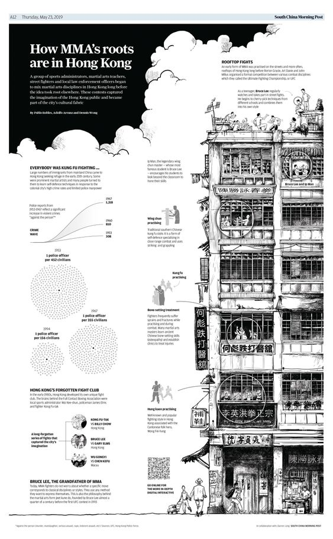

# CASE-12-香港综合格斗发展根源｜香港综合格斗发展根源

[原图](#01-示例图) · [文字分析](#02-案例分析报告) · [基础数据与附件](#03-基础数据与附件) · [同类案例](../README.md)

**基础数据逻辑**　[编年型](../../../../01-%E4%BF%A1%E6%81%AF%E5%9B%BE%E5%BD%A2%E6%95%B0%E6%8D%AE%E9%80%BB%E8%BE%91/01-%E7%BC%96%E5%B9%B4%E5%9E%8B%E4%BF%A1%E6%81%AF%E5%9B%BE%E5%BD%A2%E6%A6%82%E5%BF%B5%E5%AE%9A%E4%B9%89.md)  
**主表现标签**　[03-时间轴型信息图形](../../00-%E6%A0%87%E7%AD%BE%E8%AF%B4%E6%98%8E.md)

## 01 示例图

[查看原尺寸](1.13.jpg)

## 02 案例分析报告

- 原图：1.13.jpg（会话附件）
- 五大基础逻辑唯一主归属：**01 编年型**
- 主表现标签：**时间轴型（主）**；辅助标签：比较型；混合型；图片式
- 作者/出处/日期/来源URL：待核验

### A｜数据逻辑
以香港功夫、俱乐部和格斗文化发展为主线，穿插年份、社会统计、人物照片与场景插画。

数据结构：年份—历史事件/人物/组织；年份—统计指标。
分类依据：主导关系为01 编年型；其他图形或次级关系不改变唯一主归属。

### B｜统计图形与计算
表现标签：时间轴型（主）；比较型；混合型；图片式。当前可确认图形结构和字段关系；原始数值、统计口径、分母和来源未完整提供，不反推。复现时补充原始数据、指标定义、单位、时间范围和计算口径。

### C｜视觉编码
建筑插画形成场景锚点；左侧时间与统计模块分区；年份和数字突出节点；人物照片和点阵图辅助解释。
点用于节点/对象定位；线用于路径、引线或连接；面用于模块/区域；体仅在确有三维表达时编码空间；符号/插画识别对象与类别；色彩/文字建立类别、层级和重点。

### D｜信息架构
最小记录单位为一个事件、对象、类别、步骤或指标条目。字段建议：record_id、item_name、category、time_or_place、attribute、value、unit、visual_role、evidence_status、source。可识别条目见基础数据CSV；未知数值留空。

### E｜视觉叙事
从本地武术文化和社会背景切入，沿历史节点说明格斗文化形成。

### 图形特性
以香港功夫、俱乐部和格斗文化发展为主线，穿插年份、社会统计、人物照片与场景插画。

### 制作方法
历史叙事与统计证据分层；年表字段与指标字段分表；相关统计不直接写成因果证明。

### 制作流程
资料收集→年份/人物核验→统计来源核验→主线排序→分栏布局→插画→因果措辞审校。

### 图表垃圾检查
删除无信息功能且干扰阅读的装饰；检查图例、单位、比例、标注和阅读顺序；避免插画面积造成数量误读。

### 数据局限
分析依据为上传图片。小字和数值不可辨识时不转录；作者、出处、日期、来源和归档许可待核验。CSV为可见条目结构化记录，不是完整原始数据集。原图二进制需补传至仓库。

## 03 基础数据与附件

| 资料 | 文件 |
| --- | --- |
| 基础数据 | [基础数据.csv](%E5%9F%BA%E7%A1%80%E6%95%B0%E6%8D%AE.csv) |

### 基础数据预览

显示 前 5 条，CSV 共 8 条记录。空白沿用原 CSV。

| record\_id | item\_name | category | time\_or\_place | attribute | value | unit | visual\_role | evidence\_status | source |
| --- | --- | --- | --- | --- | --- | --- | --- | --- | --- |
| 12-01 | 1953 |  |  |  |  |  | 图面可见条目 | visible\_label\_or\_structure | 1.13.jpg |
| 12-02 | 1960 |  |  |  |  |  | 图面可见条目 | visible\_label\_or\_structure | 1.13.jpg |
| 12-03 | 1967 |  |  |  |  |  | 图面可见条目 | visible\_label\_or\_structure | 1.13.jpg |
| 12-04 | 1994 |  |  |  |  |  | 图面可见条目 | visible\_label\_or\_structure | 1.13.jpg |
| 12-05 | 香港功夫文化 |  |  |  |  |  | 图面可见条目 | visible\_label\_or\_structure | 1.13.jpg |
