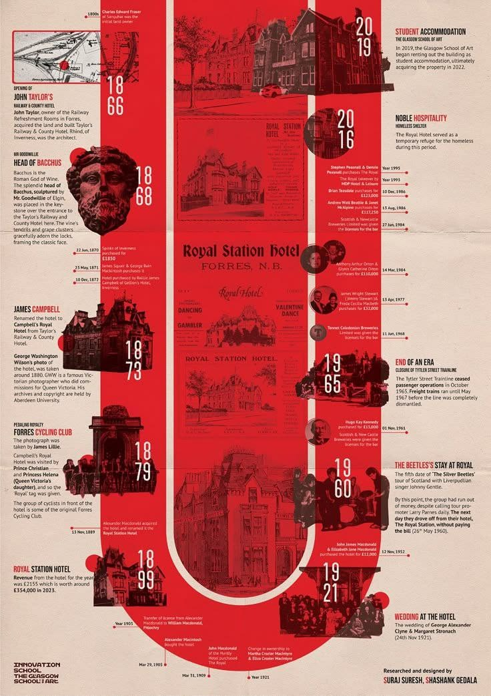

# CASE-40｜Royal Station Hotel, Forres（皇家车站酒店历史信息图）

[原图](#01-示例图) · [文字分析](#02-案例分析报告) · [基础数据与附件](#03-基础数据与附件) · [同类案例](../README.md)

**基础数据逻辑**　[编年型](../../../../01-%E4%BF%A1%E6%81%AF%E5%9B%BE%E5%BD%A2%E6%95%B0%E6%8D%AE%E9%80%BB%E8%BE%91/01-%E7%BC%96%E5%B9%B4%E5%9E%8B%E4%BF%A1%E6%81%AF%E5%9B%BE%E5%BD%A2%E6%A6%82%E5%BF%B5%E5%AE%9A%E4%B9%89.md)  
**主表现标签**　[03-时间轴型信息图形](../../00-%E6%A0%87%E7%AD%BE%E8%AF%B4%E6%98%8E.md)

## 01 示例图

[查看原尺寸](48689070e46426f2939214a35e9a9de0.jpg)

## 02 案例分析报告

### 元数据
- 案例 ID：CASE-40
- 作品名称：Royal Station Hotel, Forres, N.B.
- 作者／研究与设计：Suraj Suresh、Shashank Gedala（图面署名）
- 发布机构／发布日期：Innovation School, The Glasgow School of Art；发布日期待核验
- 原图文件名：48689070e46426f2939214a35e9a9de0.jpg（另有 royal-hotel-timeline.jpg、chart-1.png 重复副本）
- 原图尺寸：736 × 1042 px
- 原始来源 URL／公开归档许可：待核验
- 分析日期：2026-11-23

### 五大基础类型主归属
- **唯一主归属：01｜编年型信息图形**
- **主表现标签：03｜时间轴型（Timeline）**
- 辅助表现特征：历史图像、建筑图像、人物肖像与注释文本组合；不另增市场表现标签。

#### 判断依据
作品围绕 Forres 的 Royal Station Hotel 展开，以年份和日期为主要组织键，将酒店的建立、经营、人物、活动、功能变化及后续使用情况串联起来。画面中央以连续弯曲的纵向路径连接不同历史阶段，年份作为显著节点，左右两侧补充事件说明和历史图像。读者主要依照时间节点理解酒店的历史变化，因此基础数据逻辑属于编年型。

#### 排除其他基础类型
- **层级型：** 未见以父子从属或等级递进作为主组织关系。
- **编目型：** 画面虽包含多个主题模块，但整体由时间先后统摄，不是编年与层级逻辑的组合。
- **字母表型：** 不以多个并列独立元素的均匀检索为主。
- **地理图型：** 地图仅用于定位酒店，不主导信息组织。

### A｜基本数据逻辑
- 最小记录单位：与酒店历史相关的事件或阶段。
- 核心组织字段：事件日期／年份。
- 关联字段：事件名称、人物或机构、事件说明、历史图像。
- 数据关系：时间节点 → 对应历史事件 → 相关人物／建筑／经营活动。
- 时间范围：图面可见早期背景为 1800s，延伸至 2022；部分事件以具体日、月、年标注。
- 图面可见的事件主题包括早期业主背景、酒店开业、Bacchus 雕塑、酒店更名、骑行俱乐部、酒店收入、产权／经营记录、婚礼、The Beatles 到访、铁路服务结束、临时收容用途、学生住宿及 2022 年物业收购。

### 图面可辨识的时间节点\n\n| 时间 | 事件或主题 | 状态 |\n|---|---|---|\n| 1800s | Charles Edward Fraser 与早期历史背景 | 待史料核验 |\n| 1866 | John Taylor 与 Railway Refreshment Rooms 相关事件 | 待史料核验 |\n| 1868 | Head of Bacchus | 图面可辨识 |\n| 1873 | James Campbell 与酒店更名、经营相关信息 | 待史料核验 |\n| 1879 | Forres Cycling Club 相关记录 | 图面可辨识 |\n| 1899 | Royal Station Hotel 收入信息 | 图面可辨识 |\n| 1905 | 酒店产权或经营记录 | 待核验 |\n| 1921 | 酒店所有权变化相关记录 | 待核验 |\n| 1952 | 酒店相关购买或经营记录 | 待核验 |\n| 1960 | The Beatles 到访酒店 | 图面可辨识 |\n| 1961 | 酒店及周边经营活动相关记录 | 待核验 |\n| 1965 | 铁路服务结束相关事件 | 图面可辨识 |\n| 1977、1984、1986、1993、1995 | 酒店后续产权、经营或使用历史节点 | 待核验 |\n| 2016 | Royal Hotel 曾作为临时收容场所 | 图面可辨识 |\n| 2019 | Glasgow School of Art 开始将建筑用作学生住宿 | 图面可辨识 |\n| 2022 | Glasgow School of Art 收购相关物业 | 待核验 |\n\n以上内容来自现有历史分析稿与原图可读信息的交叉整理，不代表已完成独立史料核验。\n\n## B｜统计图形与计算
- 本图不是以数值统计为核心的统计图表。
- 主图形是时间轴与事件节点；年份、日期承担时间定位功能。
- 图面出现酒店收入等数值信息，但其作用是历史注释，不能据此推断整张图为统计图。
- 未对图面文字进行完整数据转录；金额、日期和事件细节应以原图高清文本核验后再结构化。

### C｜视觉编码
- **线：** 中央连续弯曲的红色路径组织时间推进；节点连接时间与事件。
- **点：** 红色圆点及人物／事件图像附近的节点提示具体时间。
- **面：** 大面积红色纵向区域形成主叙事通道，浅色底承载左右注释。
- **图像：** 酒店历史照片、建筑图像、人物肖像和相关历史图像作为事件证据与视觉锚点。
- **文字：** 大号年份建立时间层级，粗体小标题标识事件主题，正文解释背景。
- **色彩：** 红色主要承担路径强调与版面统合；未见证据表明其编码数值大小。

### D｜数据／信息架构
建议数据表采用“一行一个历史事件”的粒度，字段包括：
- event_id：事件唯一编号。
- date_text：原图显示的日期文本。
- year：可确认的年份；无法确认时留空。
- event_title：事件标题。
- event_description：事件说明。
- person_or_organization：相关人物／机构。
- image_reference：关联图像说明。
- source_status：图面可见／待核验。

本次不从低清晰度文字中补造完整事件表；应在原图文本逐项校验后再建立正式 CSV。

### E｜视觉叙事架构
1. 以酒店名称和中央建筑图像建立主题入口。
2. 沿中央弯曲时间路径向下浏览历史阶段。
3. 通过大号年份定位关键节点。
4. 在左右两侧读取事件标题、人物、日期和解释文本。
5. 通过底部较晚年份的事件收束酒店用途与历史延续。

该作品采用单一时间主线与左右分栏注释相结合的叙事方式，兼具连续阅读和局部跳读。

### 图形特性与制作流程
- 以时间轴作为全图主骨架，先确定事件时间，再组织图文内容。
- 将事件拆成可独立阅读的节点，并为节点匹配照片、建筑图或人物肖像。
- 使用年份字号、路径位置和图像大小建立视觉重点。
- 将说明文字分布于主轴两侧，减少主轴拥挤。
- 最后校验日期、事件与图片的对应关系。

### 待核验事项
- 原始发布页面、完整发布日期及授权／归档许可。
- 图面所有小字号日期、金额和事件文字。
- 中央路径上个别节点的精确日期与事件归属。
- 原图是否有可下载的更高清版本。
- 原图二进制目前可从用户历史资料中读取，但尚未提交至 GitHub 案例目录。

## 03 基础数据与附件

| 资料 | 文件 |
| --- | --- |
| 基础数据 | [基础数据.csv](%E5%9F%BA%E7%A1%80%E6%95%B0%E6%8D%AE.csv) |
| 补充资料 | [数据字典.csv](%E6%95%B0%E6%8D%AE%E5%AD%97%E5%85%B8.csv) |

### 基础数据预览

显示 前 5 条，CSV 共 20 条记录。空白沿用原 CSV。

| event\_id | date\_text | event\_title | source\_status |
| --- | --- | --- | --- |
| E001 | 1800s | Charles Edward Fraser与早期历史背景 | 待史料核验 |
| E002 | 1866 | John Taylor与Railway Refreshment Rooms相关事件 | 待史料核验 |
| E003 | 1868 | Head of Bacchus | 图面可辨识 |
| E004 | 1873 | James Campbell与酒店更名及经营相关信息 | 待史料核验 |
| E005 | 1879 | Forres Cycling Club相关记录 | 图面可辨识 |
