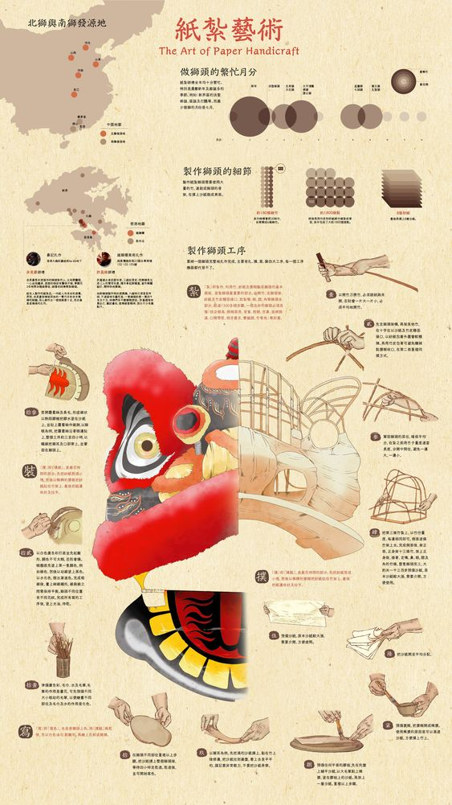

# CASE-11-纸扎艺术制作技艺｜纸扎艺术制作技艺

[原图](#01-示例图) · [文字分析](#02-案例分析报告) · [基础数据与附件](#03-基础数据与附件) · [同类案例](../README.md)

**基础数据逻辑**　[编年型](../../../../01-%E4%BF%A1%E6%81%AF%E5%9B%BE%E5%BD%A2%E6%95%B0%E6%8D%AE%E9%80%BB%E8%BE%91/01-%E7%BC%96%E5%B9%B4%E5%9E%8B%E4%BF%A1%E6%81%AF%E5%9B%BE%E5%BD%A2%E6%A6%82%E5%BF%B5%E5%AE%9A%E4%B9%89.md)  
**主表现标签**　[04-示意图型-How-to](../../00-%E6%A0%87%E7%AD%BE%E8%AF%B4%E6%98%8E.md)

## 01 示例图

[查看原尺寸](1.12.jpg)

## 02 案例分析报告

- 原图：1.12.jpg（会话附件）
- 五大基础逻辑唯一主归属：**01 编年型**
- 主表现标签：**示意图型（主）**；辅助标签：流程图型；地标型；图片式
- 作者/出处/日期/来源URL：待核验

### A｜数据逻辑
介绍纸扎艺术地域来源、材料、制作细节和工序，以中心工艺场景及环绕步骤插画组织内容。

数据结构：工序步骤—动作—工具/材料—阶段结果；地域来源为辅助字段。
分类依据：主导关系为01 编年型；其他图形或次级关系不改变唯一主归属。

### B｜统计图形与计算
表现标签：示意图型（主）；流程图型；地标型；图片式。当前可确认图形结构和字段关系；原始数值、统计口径、分母和来源未完整提供，不反推。复现时补充原始数据、指标定义、单位、时间范围和计算口径。

### C｜视觉编码
中心作品插画为锚点；周边手部动作插画编码步骤；编号形成操作顺序；地图标示来源。
点用于节点/对象定位；线用于路径、引线或连接；面用于模块/区域；体仅在确有三维表达时编码空间；符号/插画识别对象与类别；色彩/文字建立类别、层级和重点。

### D｜信息架构
最小记录单位为一个事件、对象、类别、步骤或指标条目。字段建议：record_id、item_name、category、time_or_place、attribute、value、unit、visual_role、evidence_status、source。可识别条目见基础数据CSV；未知数值留空。

### E｜视觉叙事
从地域和技艺背景进入，围绕中心作品观察材料与工序，再按步骤理解制作。

### 图形特性
介绍纸扎艺术地域来源、材料、制作细节和工序，以中心工艺场景及环绕步骤插画组织内容。

### 制作方法
将工艺拆成单动作步骤；每步配动作图、工具材料和结果说明；统一视角与编号。

### 制作流程
资料收集→工序核验→步骤拆解→工具清单→动作绘制→编号→背景排版。

### 图表垃圾检查
删除无信息功能且干扰阅读的装饰；检查图例、单位、比例、标注和阅读顺序；避免插画面积造成数量误读。

### 数据局限
分析依据为上传图片。小字和数值不可辨识时不转录；作者、出处、日期、来源和归档许可待核验。CSV为可见条目结构化记录，不是完整原始数据集。原图二进制需补传至仓库。

## 03 基础数据与附件

| 资料 | 文件 |
| --- | --- |
| 基础数据 | [基础数据.csv](%E5%9F%BA%E7%A1%80%E6%95%B0%E6%8D%AE.csv) |

### 基础数据预览

显示 前 5 条，CSV 共 6 条记录。空白沿用原 CSV。

| record\_id | item\_name | category | time\_or\_place | attribute | value | unit | visual\_role | evidence\_status | source |
| --- | --- | --- | --- | --- | --- | --- | --- | --- | --- |
| 11-01 | 地域来源 |  |  |  |  |  | 图面可见条目 | visible\_label\_or\_structure | 1.12.jpg |
| 11-02 | 材料准备 |  |  |  |  |  | 图面可见条目 | visible\_label\_or\_structure | 1.12.jpg |
| 11-03 | 造型制作 |  |  |  |  |  | 图面可见条目 | visible\_label\_or\_structure | 1.12.jpg |
| 11-04 | 骨架/结构 |  |  |  |  |  | 图面可见条目 | visible\_label\_or\_structure | 1.12.jpg |
| 11-05 | 装饰处理 |  |  |  |  |  | 图面可见条目 | visible\_label\_or\_structure | 1.12.jpg |
