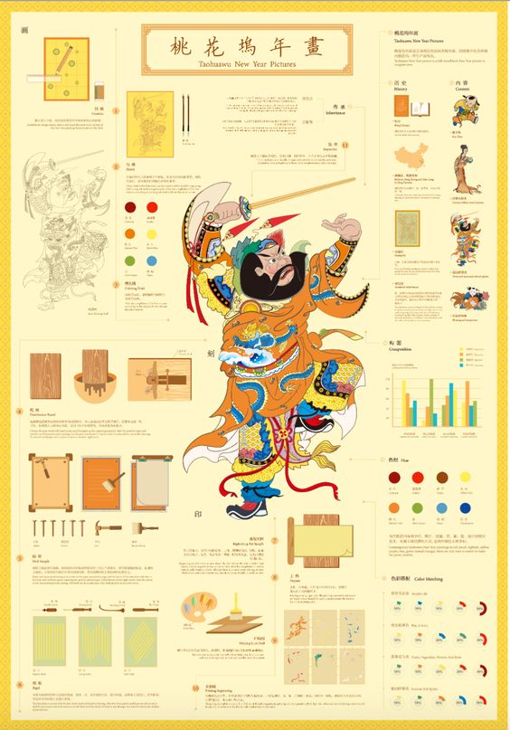

# CASE-26｜桃花坞年画｜传统木版年画

[原图](#01-示例图) · [文字分析](#02-案例分析报告) · [基础数据与附件](#03-基础数据与附件) · [同类案例](../README.md)

**基础数据逻辑**　[编目型](../../../../01-%E4%BF%A1%E6%81%AF%E5%9B%BE%E5%BD%A2%E6%95%B0%E6%8D%AE%E9%80%BB%E8%BE%91/03-%E7%BC%96%E7%9B%AE%E5%9E%8B%E4%BF%A1%E6%81%AF%E5%9B%BE%E5%BD%A2%E6%A6%82%E5%BF%B5%E5%AE%9A%E4%B9%89.md)  
**主表现标签**　[04-示意图型-How-to](../../00-%E6%A0%87%E7%AD%BE%E8%AF%B4%E6%98%8E.md)

## 01 示例图

[查看原尺寸](2.26.jpg)

## 02 案例分析报告

### 元数据
- 案例 ID／作品名：CASE-26｜桃花坞年画｜传统木版年画
- 原图文件名：2.26.jpg
- 作者／发布机构／发布日期：未从当前图片确认
- 原始来源 URL：未提供，待核验
- 原图归档许可：待核验；当前仅记录用户本次上传的研究材料
- 分析日期：2026-11-22
- 数据时间范围与单位：按图面可辨信息逐项记录；未读清处留空

### 五大基础类型主归属（唯一）
- 主归属：03 编目型
- 判断依据：主要围绕桃花坞年画这一传统工艺，展示历史/文化背景、工具材料、制作工序、作品内容、色彩与构图等知识条目；工序顺序是重要子结构。
- 排除其他类型的理由：主分类依据是全图主导的数据/信息关系，不因局部出现地图、时间、流程、层级或3D插画而改变。
- 主表现标签：04-示意图型-How-to
- 辅助表现标签：08-图片式-Photo-graphic、01-混合型信息图形（Mixed Charts）

### A｜基本数据逻辑
最小单元为工艺环节、工具/材料、作品元素、色彩类别和文化信息条目；部分工序文字较小需人工核验。

### B｜统计图形与计算
步骤示意、工具/材料图、颜色样本、局部作品图、少量柱状统计或分类图表。

### C｜视觉编码
黄色纸本底营造传统印刷质感；中央人物年画作品作视觉锚点；周围以线描工具、材料和局部图解；色样以色块编码；细线和编号指向制作细节。

### D｜数据／信息架构
- 建议数据粒度：一行代表一个独立条目/事件/地点/部件。
- 字段建议：record_id、entity、category、period_or_location、attribute、value、unit、visual_role、source_note。
- 具体图面可辨条目见同目录《基础数据.csv》。
- 当前数据表属于依据图面反向提取的基础条目，不代表已取得原始研究数据集。

### E｜视觉叙事架构
先展示年画成品及文化身份，再逐步拆解制作工具、材料、版刻/印制过程与色彩构成，帮助读者理解作品如何形成。

### 制作方法
采集工艺流程、工具材料和作品图像；将动作拆成单步示意；用同一线描风格和色彩体系保持信息一致。

### 制作流程
1.核对桃花坞年画工艺资料；2.拆分工具、材料、版刻、套色等步骤；3.收集作品和局部图像；4.绘制步骤分解图；5.建立颜色与工艺信息模块；6.按成品—工具—流程—文化排版；7.核对术语。

### 结论与知识回写
- 可复用规律：黄色纸本底营造传统印刷质感；中央人物年画作品作视觉锚点；周围以线描工具、材料和局部图解；色样以色块编码；细线和编号指向制作细节。
- 适用条件：主题具有可分类条目、可解释的对象关系，且图面需要兼顾总览与细节。
- 待核验问题：图面正文有部分不可辨认，工艺环节名称和数字不能仅凭模糊缩略图转录；统计图若未读清则仅记为存在。
- 原图文件二进制：本次上传文件仍保留在当前对话；仓库暂存分析和CSV，原图二进制待通过支持二进制的仓库上传方式补入。

## 03 基础数据与附件

| 资料 | 文件 |
| --- | --- |
| 基础数据 | [基础数据.csv](%E5%9F%BA%E7%A1%80%E6%95%B0%E6%8D%AE.csv) |

### 基础数据预览

显示 5 条记录。空白沿用原 CSV。

| record\_id | entity | category | period\_or\_location | attribute | value | unit | visual\_role | source\_note |
| --- | --- | --- | --- | --- | --- | --- | --- | --- |
| 26-1 | Finished print | 作品 | 年画 | 中央年画人物/作品 |  |  | 主插画 |  |
| 26-2 | Tools | 工具集合 | 制作 | 版刻/印制相关工具图 |  |  | 工具图解 |  |
| 26-3 | Materials | 材料集合 | 制作 | 纸张、颜料等材料线索 |  |  | 材料模块 |  |
| 26-4 | Process | 工艺步骤 | 制作 | 制作工序的分解示意 |  |  | 步骤图 |  |
| 26-5 | Color samples | 色彩类别 | 视觉语言 | 多种色彩样本 |  |  | 色块编码 |  |
