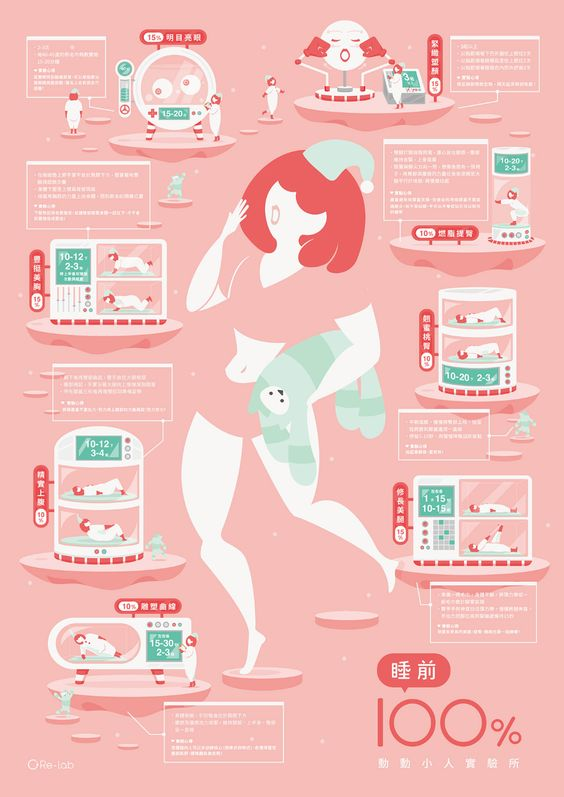

# CASE-33｜睡前活动与助眠

[原图](#01-示例图) · [文字分析](#02-案例分析报告) · [基础数据与附件](#03-基础数据与附件) · [同类案例](../README.md)

**基础数据逻辑**　[编目型](../../../../01-%E4%BF%A1%E6%81%AF%E5%9B%BE%E5%BD%A2%E6%95%B0%E6%8D%AE%E9%80%BB%E8%BE%91/03-%E7%BC%96%E7%9B%AE%E5%9E%8B%E4%BF%A1%E6%81%AF%E5%9B%BE%E5%BD%A2%E6%A6%82%E5%BF%B5%E5%AE%9A%E4%B9%89.md)  
**主表现标签**　[04-示意图型-How-to](../../00-%E6%A0%87%E7%AD%BE%E8%AF%B4%E6%98%8E.md)

## 01 示例图

[查看原尺寸](3.6.jpg)

## 02 案例分析报告

### 元数据
- 原图文件名：3.6.jpg
- 作者/发布机构/日期/来源URL：未从图面确认，待核验
- 归档许可：待核验；本次仅作研究分析
- 分析日期：2026-11-22

### 五大基础类型主归属（唯一）
- 主归属：03 编目型
- 判断依据：周边模块展示睡前活动/动作、时间次数提示与说明，按活动条目集合组织；不能确定是强制步骤序列。
- 主表现标签：04-示意图型-How-to
- 辅助标签：05-流程图型-Process、01-混合型信息图形（Mixed Charts）

### A｜基本数据逻辑
周边模块展示睡前活动/动作、时间次数提示与说明，按活动条目集合组织；不能确定是强制步骤序列。

建议数据粒度：一行代表一个独立条目（动作、构件、地点、事件或指标）。建议字段：record_id、entity、category、period_or_location、attribute、value、unit、visual_role、source_note。

### B｜统计图形与计算
动作插画、时间/次数标签、模块清单；未见可靠统计图。

### C｜视觉编码
粉色底色，中央人物作为主题锚点；周边平台/卡片呈现动作；红色竖标签和绿色数值标签强调模块。

### D｜数据/信息架构
中央人物与睡前主题为总览，四周独立动作模块；每个模块由动作图、数字和说明构成。

基础数据CSV记录图面可辨认的条目；未读清数值留空，不把插画当作样本数量，不把空间隐喻当作比例尺度。

### E｜视觉叙事
从睡前主题进入，浏览多个活动场景；顺序关系待高清原图确认。

### 制作方法
先核对动作名称与时间建议，再制作独立模块，避免将并列建议误画成步骤。

### 制作流程
获取高清原文；转录动作与时间；区分并列/顺序；绘制统一动作图；校对健康建议。

### 结论与知识回写
- 可复用设计特征：粉色底色，中央人物作为主题锚点；周边平台/卡片呈现动作；红色竖标签和绿色数值标签强调模块。
- 待核验：只能确认底部出现“睡前”“100%”等线索；不解释为疗效百分比。
- 原图文件：3.6.jpg（本次对话附件；仓库暂未写入二进制原图）

## 03 基础数据与附件

| 资料 | 文件 |
| --- | --- |
| 基础数据 | [基础数据.csv](%E5%9F%BA%E7%A1%80%E6%95%B0%E6%8D%AE.csv) |

### 基础数据预览

显示 4 条记录。空白沿用原 CSV。

| record\_id | entity | category | period\_or\_location | attribute | value | unit | visual\_role | source\_note |
| --- | --- | --- | --- | --- | --- | --- | --- | --- |
| 33-1 | 主题主对象 | 主题对象 | 主题 | 核心对象/主题模块 |  |  | 主视觉/入口 |  |
| 33-2 | 分类条目 | 信息条目 | 类别 | 图面中可辨认的分类或模块 |  |  | 分类模块 |  |
| 33-3 | 流程/时间/空间 | 关系字段 | 关系 | 图示的步骤、时间或空间关联 |  |  | 结构编码 |  |
| 33-4 | 解释性插画 | 视觉对象 | 说明 | 解释对象结构/场景的插画 |  |  | 解释图像 |  |
