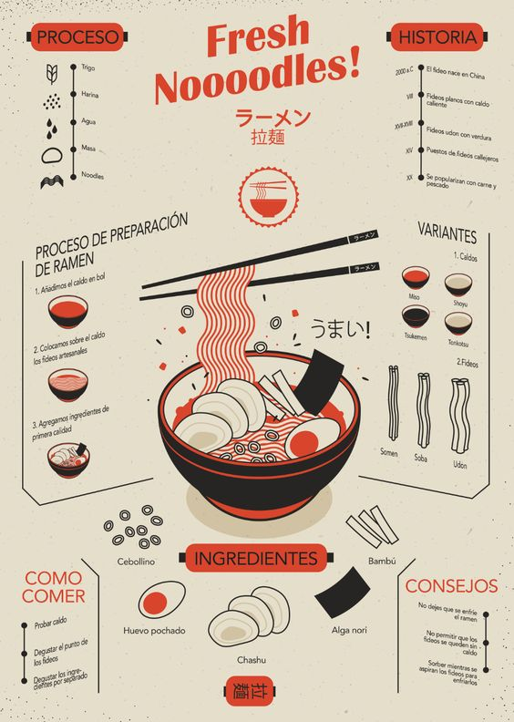

# CASE-53｜Fresh Noodles!｜拉面知识与制作

[原图](#01-示例图) · [文字分析](#02-案例分析报告) · [基础数据与附件](#03-基础数据与附件) · [同类案例](../README.md)

**基础数据逻辑**　[编目型](../../../../01-%E4%BF%A1%E6%81%AF%E5%9B%BE%E5%BD%A2%E6%95%B0%E6%8D%AE%E9%80%BB%E8%BE%91/03-%E7%BC%96%E7%9B%AE%E5%9E%8B%E4%BF%A1%E6%81%AF%E5%9B%BE%E5%BD%A2%E6%A6%82%E5%BF%B5%E5%AE%9A%E4%B9%89.md)  
**主表现标签**　[04-示意图型-How-to](../../00-%E6%A0%87%E7%AD%BE%E8%AF%B4%E6%98%8E.md)

## 01 示例图

[查看原尺寸](4b38e194c1b680c2b1affc2ce9199c78.jpg)

## 02 案例分析报告

### 元数据
- 案例 ID：CASE-53
- 原始上传文件名：4b38e194c1b680c2b1affc2ce9199c78.jpg
- 五大基础逻辑唯一主归属：03 编目型
- 主表现标签：04 示意图型／How-to
- 分析依据：本次上传原图；细小文字与数值未逐项独立核验

### 01｜五大基础类型判断
**唯一主归属：03 编目型。**

由制作过程、历史、面条变体、配料、食用方法和建议等多个并列主题构成；制作步骤是核心子模块之一。

### 02｜表现形式标签
**主标签：04 示意图型／How-to。**该标签描述画面表达方式，不替代五大基础数据逻辑分类。

### A｜基本数据逻辑
由制作过程、历史、面条变体、配料、食用方法和建议等多个并列主题构成；制作步骤是核心子模块之一。

### B｜统计图形与计算方式
步骤示意、分类图标、配料清单、变体对照；无统一数值坐标系。
图面未明确标注的数据来源、单位、计算口径或样本不作推断；数值须回到原始来源核验。

### C｜视觉编码
中央拉面碗为主视觉；四周分区承载制作、历史、变体、配料与建议；步骤符号和小图标帮助理解；红黑米色形成主题色。
- 点：节点、项目或条目标记，按图中实际用途使用。
- 线：连接顺序、引导视线或标注对象。
- 面：模块分区、背景分组或主题区域。
- 体：三维主体／轴测图承担空间结构表达，不把装饰性立体效果等同于数据量。
- 符号：图标、编号、人物／物件剪影承担类别识别。
- 色彩：建立主题统一、模块区分和重点强调；无图例时不擅自赋予定量含义。

### D｜数据／信息架构
拉面主题→制作方法／历史／变体／配料／食用建议；各模块含步骤或条目。

建议字段：case_id、item_id、category、sequence_or_position、label、description、value、unit、source、source_status。仅录入图面明确支持的字段；无法辨认的数值留空并标记待核验。

### E｜视觉叙事架构
从中央成品建立兴趣，再分别说明制作、历史、品种、配料和食用建议，可按需跳读。

### 图形特性
多主题知识图中嵌入How-to说明；重点是让读者看懂怎么做与如何选择。

### 制作方法与流程
确定操作目标→拆分主题→排序制作动作→绘制配料器具图标→建立中央成品图→安排模块→核对步骤。

### 归档信息
- 表现标签目录：02-信息图形类型案例/04-示意图型-How-to/
- 案例目录：02-信息图形类型案例/04-示意图型-How-to/案例/CASE-53-Fresh-Noodles-拉面知识与制作/
- 原图目标路径：02-信息图形类型案例/04-示意图型-How-to/案例/CASE-53-Fresh-Noodles-拉面知识与制作/原图/4b38e194c1b680c2b1affc2ce9199c78.jpg
- 原图保留要求：保持上传原始文件，不以裁切、压缩或重绘版本替代。
- 原图二进制：需在 GitHub 提交后再标记为已入库。

### 更新记录
- 2026-11-23：依据本次上传原图完成初步分类与视觉分析。

## 03 基础数据与附件

| 资料 | 文件 |
| --- | --- |
| 基础数据 | [基础数据.csv](%E5%9F%BA%E7%A1%80%E6%95%B0%E6%8D%AE.csv) |

### 基础数据预览

显示 前 5 条，CSV 共 9 条记录。空白沿用原 CSV。

| field | value | source\_status |
| --- | --- | --- |
| case\_id | CASE-53 | 已确认 |
| title | Fresh Noodles!｜拉面知识与制作 | 图面可辨识 |
| original\_filename | 4b38e194c1b680c2b1affc2ce9199c78.jpg | 上传文件名 |
| primary\_logic | 03 编目型 | 分类判断 |
| primary\_tag | 04 示意图型／How-to | 分类判断 |
