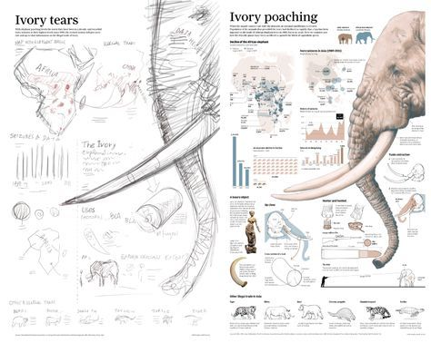

# CASE-19｜Ivory Tears / Ivory Poaching｜象牙贸易与偷猎

[原图](#01-示例图) · [文字分析](#02-案例分析报告) · [基础数据与附件](#03-基础数据与附件) · [同类案例](../README.md)

**基础数据逻辑**　[地理图型](../../../../01-%E4%BF%A1%E6%81%AF%E5%9B%BE%E5%BD%A2%E6%95%B0%E6%8D%AE%E9%80%BB%E8%BE%91/05-%E5%9C%B0%E7%90%86%E5%9B%BE%E5%BD%A2%E4%BF%A1%E6%81%AF%E5%9B%BE%E5%BD%A2%E6%A6%82%E5%BF%B5%E5%AE%9A%E4%B9%89.md)  
**主表现标签**　[07-地标型-Location](../../00-%E6%A0%87%E7%AD%BE%E8%AF%B4%E6%98%8E.md)

## 01 示例图

[查看原尺寸](1.25.jpg)

## 02 案例分析报告

### 元数据
- 案例 ID／作品名：CASE-19｜Ivory Tears / Ivory Poaching｜象牙贸易与偷猎
- 原图文件名：1.25.jpg
- 作者／发布机构／发布日期：未从当前图片确认
- 原始来源 URL：未提供，待核验
- 原图归档许可：待核验；当前仅记录用户本次上传的研究材料
- 分析日期：2026-11-22
- 数据时间范围与单位：按图面可辨信息逐项记录；未读清处留空

### 五大基础类型主归属（唯一）
- 主归属：05 地理图型
- 判断依据：右侧以非洲及亚洲相关地区地图呈现偷猎/贸易空间分布，并组合数量、趋势和象牙结构解释；地图承担空间定位与分布比较，不只是装饰背景。左侧草图是研究过程和视觉草案，不构成另一主类型。
- 排除其他类型的理由：主分类依据是全图主导的数据/信息关系，不因局部出现地图、时间、流程、层级或3D插画而改变。
- 主表现标签：07-地标型-Location
- 辅助表现标签：01-混合型信息图形（Mixed Charts）、12-解剖型-Anatomical、14-手稿型-Hand-drawn

### A｜基本数据逻辑
地点/区域—偷猎或贸易相关指标—时间/趋势—象牙用途与结构说明。最小记录单元可设为地区或被解释的象牙部位；原始数据表未提供。

### B｜统计图形与计算
区域地图/点位或分布地图、趋势图、柱状统计、结构示意；图中具体统计口径、单位与分母需回查原始出版物，不能从低清图推定。

### C｜视觉编码
地图面/点用于地区定位；柱形和折线用于数量或趋势；大象头部与象牙插画为主题锚点；草图线条表现研究过程；灰黑与浅米色控制信息密度。

### D｜数据／信息架构
- 建议数据粒度：一行代表一个独立条目/事件/地点/部件。
- 字段建议：record_id、entity、category、period_or_location、attribute、value、unit、visual_role、source_note。
- 具体图面可辨条目见同目录《基础数据.csv》。
- 当前数据表属于依据图面反向提取的基础条目，不代表已取得原始研究数据集。

### E｜视觉叙事架构
从象牙议题和非洲空间背景进入，转向偷猎/贸易空间证据，再以统计图和象牙结构、用途说明解释问题；阅读由议题定位到证据和对象细节。

### 制作方法
先建立地区—时间—指标数据表，再准备地理底图和统计图；将对象结构图作为解释性图像，与空间证据分区排版。

### 制作流程
1.核验地区、时期、偷猎/贸易指标及来源；2.统一国家/地区名称和单位；3.制作地图与趋势统计；4.绘制象牙/大象结构说明；5.按议题—空间证据—对象解释组织版面；6.复核图例、比例与来源。

### 结论与知识回写
- 可复用规律：地图面/点用于地区定位；柱形和折线用于数量或趋势；大象头部与象牙插画为主题锚点；草图线条表现研究过程；灰黑与浅米色控制信息密度。
- 适用条件：主题具有可分类条目、可解释的对象关系，且图面需要兼顾总览与细节。
- 待核验问题：标题为 Ivory Tears / Ivory Poaching。图中文字和数值较小，无法可靠读取的地区数值、比例和年份留空；左页为草图/研究稿，不将草图注释当作已验证数据。
- 原图文件二进制：本次上传文件仍保留在当前对话；仓库暂存分析和CSV，原图二进制待通过支持二进制的仓库上传方式补入。

## 03 基础数据与附件

| 资料 | 文件 |
| --- | --- |
| 基础数据 | [基础数据.csv](%E5%9F%BA%E7%A1%80%E6%95%B0%E6%8D%AE.csv) |

### 基础数据预览

显示 4 条记录。空白沿用原 CSV。

| record\_id | entity | category | period\_or\_location | attribute | value | unit | visual\_role | source\_note |
| --- | --- | --- | --- | --- | --- | --- | --- | --- |
| 19-1 | Africa | 区域 | 空间分布 | 象牙偷猎/贸易相关区域 |  |  | 地图定位 |  |
| 19-2 | Asia | 区域 | 空间分布 | 象牙需求/贸易相关区域 |  |  | 地图定位 |  |
| 19-3 | Elephant tusk | 对象部件 | 结构说明 | 象牙结构与用途 |  |  | 结构插画 |  |
| 19-4 | Poaching indicators | 统计指标 | 趋势/比较 | 图中存在统计图表，精确数值不可辨 |  |  | 统计图 |  |
