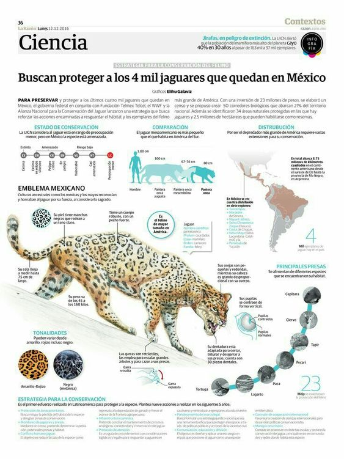

# CASE-24｜Buscan proteger a los 4 mil jaguares que quedan en México｜墨西哥美洲豹保护

[原图](#01-示例图) · [文字分析](#02-案例分析报告) · [基础数据与附件](#03-基础数据与附件) · [同类案例](../README.md)

**基础数据逻辑**　[地理图型](../../../../01-%E4%BF%A1%E6%81%AF%E5%9B%BE%E5%BD%A2%E6%95%B0%E6%8D%AE%E9%80%BB%E8%BE%91/05-%E5%9C%B0%E7%90%86%E5%9B%BE%E5%BD%A2%E4%BF%A1%E6%81%AF%E5%9B%BE%E5%BD%A2%E6%A6%82%E5%BF%B5%E5%AE%9A%E4%B9%89.md)  
**主表现标签**　[07-地标型-Location](../../00-%E6%A0%87%E7%AD%BE%E8%AF%B4%E6%98%8E.md)

## 01 示例图

[查看原尺寸](2.24.jpg)

## 02 案例分析报告

### 元数据
- 案例 ID／作品名：CASE-24｜Buscan proteger a los 4 mil jaguares que quedan en México｜墨西哥美洲豹保护
- 原图文件名：2.24.jpg
- 作者／发布机构／发布日期：未从当前图片确认
- 原始来源 URL：未提供，待核验
- 原图归档许可：待核验；当前仅记录用户本次上传的研究材料
- 分析日期：2026-11-22
- 数据时间范围与单位：按图面可辨信息逐项记录；未读清处留空

### 五大基础类型主归属（唯一）
- 主归属：05 地理图型
- 判断依据：标题强调墨西哥境内剩余美洲豹保护，地图呈现墨西哥分布/栖息地并辅以南美洲范围地图；空间分布是保护策略和数量判断的重要基础。
- 排除其他类型的理由：主分类依据是全图主导的数据/信息关系，不因局部出现地图、时间、流程、层级或3D插画而改变。
- 主表现标签：07-地标型-Location
- 辅助表现标签：12-解剖型-Anatomical、06-比较型-Comparison、01-混合型信息图形（Mixed Charts）

### A｜基本数据逻辑
最小单元包括美洲豹分布区域、保护等级、体型/身体特征、猎物对象、威胁与保护措施；标题可见“约4,000只”这一报道表述，须保留其来源口径。

### B｜统计图形与计算
分布地图、体型比较图、身体部位标注、猎物对象图示、保护状态/威胁等级图标。

### C｜视觉编码
中央美洲豹大图为视觉锚点；地图面/点表达栖息地；标线连接身体部位；圆形纹样展示皮毛差异；图标和颜色区分威胁/保护状态。

### D｜数据／信息架构
- 建议数据粒度：一行代表一个独立条目/事件/地点/部件。
- 字段建议：record_id、entity、category、period_or_location、attribute、value、unit、visual_role、source_note。
- 具体图面可辨条目见同目录《基础数据.csv》。
- 当前数据表属于依据图面反向提取的基础条目，不代表已取得原始研究数据集。

### E｜视觉叙事架构
从墨西哥美洲豹数量与保护目标切入，定位其栖息地，解释体型/特征与生态关系，再呈现威胁和保护策略。

### 制作方法
将地理分布数据与物种生物学资料连接；地图与主体插画共用标注编号；通过侧栏补充比较和生态信息。

### 制作流程
1.核实约4,000只的统计来源、时间与估算方法；2.整理栖息地/分布区数据；3.整理身体特征、猎物和威胁资料；4.制作分布地图和主体解剖标注；5.按数量—空间—生态—保护组织版面；6.核验图例和保护策略出处。

### 结论与知识回写
- 可复用规律：中央美洲豹大图为视觉锚点；地图面/点表达栖息地；标线连接身体部位；圆形纹样展示皮毛差异；图标和颜色区分威胁/保护状态。
- 适用条件：主题具有可分类条目、可解释的对象关系，且图面需要兼顾总览与细节。
- 待核验问题：标题中的“4 mil”表示约4,000；该数字是报道标题表述，不可视为当前实时种群数。地图边界和分布范围需查原始来源。
- 原图文件二进制：本次上传文件仍保留在当前对话；仓库暂存分析和CSV，原图二进制待通过支持二进制的仓库上传方式补入。

## 03 基础数据与附件

| 资料 | 文件 |
| --- | --- |
| 基础数据 | [基础数据.csv](%E5%9F%BA%E7%A1%80%E6%95%B0%E6%8D%AE.csv) |

### 基础数据预览

显示 5 条记录。空白沿用原 CSV。

| record\_id | entity | category | period\_or\_location | attribute | value | unit | visual\_role | source\_note |
| --- | --- | --- | --- | --- | --- | --- | --- | --- |
| 24-1 | Mexico jaguar estimate | 种群估计 | 墨西哥 | 标题报道约4,000只 | 4000 | 只 | 标题数字，来源口径待核 |  |
| 24-2 | Jaguar range | 分布区域 | 墨西哥/拉美 | 美洲豹分布与栖息地 |  |  | 地图 |  |
| 24-3 | Body features | 身体特征 | 物种 | 体长、体重、爪/牙等标注 |  |  | 解剖标注 |  |
| 24-4 | Prey species | 猎物对象 | 栖息地 | 主要猎物图示 |  |  | 对象图示 |  |
| 24-5 | Conservation actions | 保护措施 | 墨西哥 | 保护策略与行动建议 |  |  | 文字模块 |  |
