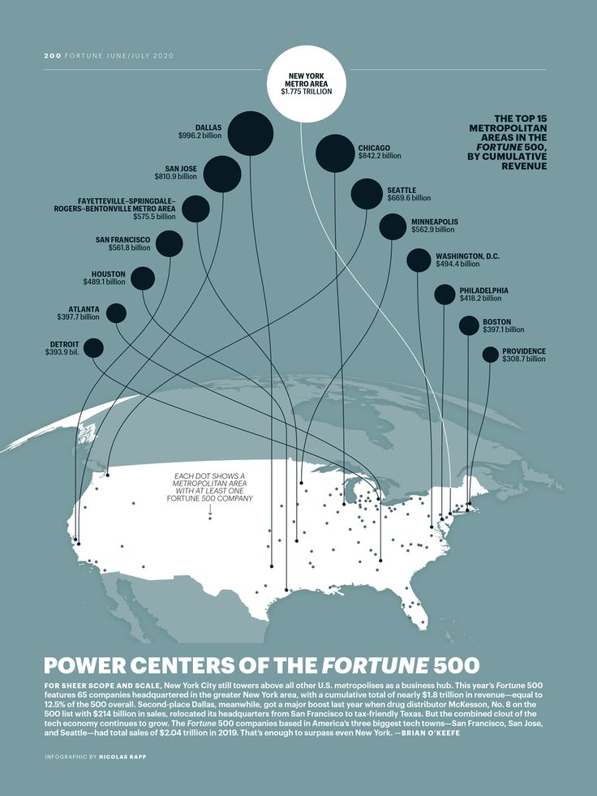

# CASE-39｜POWER CENTERS OF THE FORTUNE 500

[原图](#01-示例图) · [文字分析](#02-案例分析报告) · [基础数据与附件](#03-基础数据与附件) · [同类案例](../README.md)

**基础数据逻辑**　[地理图型](../../../../01-%E4%BF%A1%E6%81%AF%E5%9B%BE%E5%BD%A2%E6%95%B0%E6%8D%AE%E9%80%BB%E8%BE%91/05-%E5%9C%B0%E7%90%86%E5%9B%BE%E5%BD%A2%E4%BF%A1%E6%81%AF%E5%9B%BE%E5%BD%A2%E6%A6%82%E5%BF%B5%E5%AE%9A%E4%B9%89.md)  
**主表现标签**　[07-地标型-Location](../../00-%E6%A0%87%E7%AD%BE%E8%AF%B4%E6%98%8E.md)

## 01 示例图

[查看原尺寸](a2121f9ef7dae652b65823a8aba9d900.jpg)

## 02 案例分析报告

### 元数据
- 案例 ID：CASE-39
- 作品名称：POWER CENTERS OF THE FORTUNE 500
- 中文工作名：财富500强商业中心／都市圈收入分布
- 原图文件：本对话上传的 d7947c8c82a13bbde7a2b934fdfe760f.jpg（736 × 981 px）
- 刊物：FORTUNE
- 刊期：June/July 2020
- 插画署名：Nicolas Rapp
- 图中统计年度：2019
- 分析日期：2026-11-23

### 五大基础类型主归属
- **唯一主归属：05｜地理图形信息图形**
- 主表现标签：07｜地标型（Location）
- 辅助标签：06｜比较型（Comparison）；10｜单一图表型（Single Chart）

#### 判断依据
地图位置是全图的主要组织基础：美国都市圈以地理点位呈现，重点都市圈通过连接线与上方收入气泡建立空间对应。地理位置不是装饰背景，而是数据阅读和定位的必要结构，因此归入地理图型。

### A｜基本数据逻辑
- 空间对象：美国大都市区。
- 核心指标：2019 年 Fortune 500 企业在各都市圈的累计收入。
- 记录粒度：一行一个被标注的大都市区。
- 重点标注：累计收入排名前 15 的都市圈。
- 地图底图上的小点表示至少拥有一家 Fortune 500 企业的大都市区；它们与上方 15 个收入气泡不是同一层数据，不应混为一个数据表。
- 15 个重点都市圈收入值已按原图转录；纽约原值为 1.775 trillion，其余为 billion。为比较方便，工作簿另设统一单位列，将 trillion 换算为 1775 billion。

### B｜统计图形与计算
1. **地理点分布图**：用地图点标记都市圈位置，提供空间参照。
2. **比例气泡比较**：以圆形气泡表现重点都市圈累计收入的相对规模。圆面积与收入的映射属于视觉判断，原图未提供明确比例尺，不能反推出精确面积比例。
3. **排名比较**：通过前 15 个都市圈的收入标签进行数值比较；排名按图面顺序录入。
4. **单位换算**：1 trillion = 1000 billion。New York：1.775 trillion = 1775 billion。
5. 本图没有提供地图小点的逐个城市名称、经纬度或完整 Fortune 500 企业清单，因此不对未标注点做推测性补录。

### C｜视觉编码
| 数据／信息 | 视觉通道 | 作用 | 证据状态 |
|---|---|---|---|
| 都市圈位置 | 地图上的点位 | 地理定位 | 直接观察 |
| 重点都市圈收入 | 圆形气泡面积 | 数量比较 | 视觉推断，比例尺未知 |
| 气泡与地图位置关系 | 曲线连接线 | 标注对应 | 直接观察 |
| 城市收入 | 城市名与数值标签 | 精确读取 | 直接观察 |
| 纽约都市圈 | 白色大气泡及白色连接线 | 重点突出 | 直接观察 |
| 美国空间范围 | 白色地图轮廓 | 地理参照 | 直接观察 |
| 背景 | 蓝绿色底色 | 对比与氛围 | 直接观察 |

### D｜数据／信息架构
同目录提供：
- `基础数据.csv`：15 个重点都市圈，一行一个都市圈。
- `可视化拆解.xlsx`：8 个工作表，分别为城市收入、图像元数据、基础视觉元素、属性字段字典、分类与标签、编码映射、制作流程、数据限制。
- `数据字典.csv`：字段含义与单位定义。
- `数据局限.md`：未标注地图点、缺失坐标、气泡比例尺和完整企业清单等限制。

城市收入表中将原始数值、原始单位、统一数值、统一单位拆分为独立字段，避免一个单元格混放数值与单位。

### E｜视觉叙事架构
1. 标题明确主题：Fortune 500 企业在美国的都市圈收入中心。
2. 以美国地图建立整体空间框架。
3. 上方外围布置前 15 个都市圈气泡与收入标签。
4. 曲线将气泡与地图内对应地点连接，形成空间映射。
5. 纽约以白色气泡突出，建立主要视觉焦点。
6. 底部说明文字补充纽约与其他都市圈的商业规模对比。

阅读方式是“先看空间分布，再看重点都市圈收入比较”，属于地理定位驱动的比较叙事。

### 图形特性总结
- 地图点位与收入气泡采用分层表达。
- 连接线解决地图点与外围标签之间的空间对应问题。
- 大数值标签保证精确读数，气泡提供快速规模感知。
- 颜色同时承担强调与背景分层，不应误读为连续数值色阶。

### 制作方法
1. 整理都市圈与 Fortune 500 企业累计收入数据。
2. 确定统计年份、空间统计单元和排名口径。
3. 准备美国地图底图并定位都市圈。
4. 选择重点都市圈，按收入值建立气泡尺寸映射。
5. 将气泡放置于地图外围，减少遮挡。
6. 使用曲线连接气泡与地图位置。
7. 配置城市名、收入数值和排名。
8. 对重点城市使用独立颜色或样式突出。
9. 检查单位换算、标签对应和气泡比例关系。

### 可复现制作流程
数据整理 → 统计口径统一 → 都市圈地理编码 → 地图点位绘制 → 收入排名 → 气泡面积映射 → 标签布局 → 连接线绘制 → 视觉层级调整 → 单位与来源校验 → 输出。

### 待核验事项
- 15 个都市圈收入数值的原始统计来源与计算口径。
- 图面气泡的精确面积映射比例。
- 地图底图小点的完整城市名单和坐标。
- 原图归档许可待核验。

## 03 基础数据与附件

| 资料 | 文件 |
| --- | --- |
| 补充资料 | [02-图像元数据.csv](02-%E5%9B%BE%E5%83%8F%E5%85%83%E6%95%B0%E6%8D%AE.csv) |
| 补充资料 | [03-基础视觉元素.csv](03-%E5%9F%BA%E7%A1%80%E8%A7%86%E8%A7%89%E5%85%83%E7%B4%A0.csv) |
| 补充资料 | [04-属性字段字典.csv](04-%E5%B1%9E%E6%80%A7%E5%AD%97%E6%AE%B5%E5%AD%97%E5%85%B8.csv) |
| 补充资料 | [05-分类与标签.csv](05-%E5%88%86%E7%B1%BB%E4%B8%8E%E6%A0%87%E7%AD%BE.csv) |
| 补充资料 | [06-编码映射.csv](06-%E7%BC%96%E7%A0%81%E6%98%A0%E5%B0%84.csv) |
| 补充资料 | [07-制作流程.csv](07-%E5%88%B6%E4%BD%9C%E6%B5%81%E7%A8%8B.csv) |
| 补充资料 | [08-数据限制.csv](08-%E6%95%B0%E6%8D%AE%E9%99%90%E5%88%B6.csv) |
| Excel 工作簿 | [可视化拆解.xlsx](%E5%8F%AF%E8%A7%86%E5%8C%96%E6%8B%86%E8%A7%A3.xlsx) |
| 基础数据 | [基础数据.csv](%E5%9F%BA%E7%A1%80%E6%95%B0%E6%8D%AE.csv) |
| 补充资料 | [数据字典.csv](%E6%95%B0%E6%8D%AE%E5%AD%97%E5%85%B8.csv) |
| 补充资料 | [数据局限.md](%E6%95%B0%E6%8D%AE%E5%B1%80%E9%99%90.md) |

### 基础数据预览

显示 前 5 条，CSV 共 15 条记录。空白沿用原 CSV。

| ID | 大都市区 | 原始数值 | 原始单位 | 统一数值 | 统一单位 | 排名 | 年份 | 证据状态 |
| --- | --- | --- | --- | --- | --- | --- | --- | --- |
| M001 | New York | 1.775 | trillion | 1775.0 | 十亿美元 | 1 | 2019 | 图像读取 |
| M002 | Dallas | 996.2 | billion | 996.2 | 十亿美元 | 2 | 2019 | 图像读取 |
| M003 | Chicago | 842.2 | billion | 842.2 | 十亿美元 | 3 | 2019 | 图像读取 |
| M004 | San Jose | 810.9 | billion | 810.9 | 十亿美元 | 4 | 2019 | 图像读取 |
| M005 | Seattle | 669.6 | billion | 669.6 | 十亿美元 | 5 | 2019 | 图像读取 |
