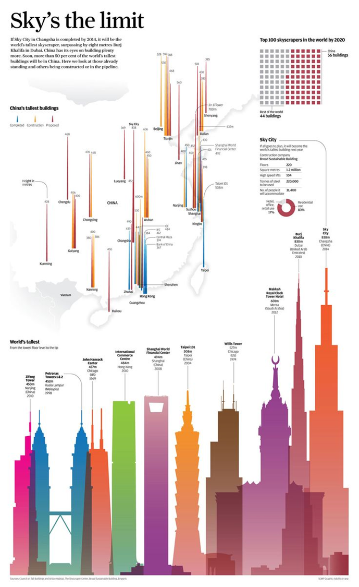

# CASE-63｜Sky’s the limit 摩天建筑高度比较

[原图](#01-示例图) · [文字分析](#02-案例分析报告) · [基础数据与附件](#03-基础数据与附件) · [同类案例](../README.md)

**基础数据逻辑**　[字母表型](../../../../01-%E4%BF%A1%E6%81%AF%E5%9B%BE%E5%BD%A2%E6%95%B0%E6%8D%AE%E9%80%BB%E8%BE%91/04-%E5%AD%97%E6%AF%8D%E8%A1%A8%E5%9E%8B%E4%BF%A1%E6%81%AF%E5%9B%BE%E5%BD%A2%E6%A6%82%E5%BF%B5%E5%AE%9A%E4%B9%89.md)  
**主表现标签**　[10-单一图表型-Single-Chart](../../00-%E6%A0%87%E7%AD%BE%E8%AF%B4%E6%98%8E.md)

## 01 示例图

[查看原尺寸](slide31_image1.png)

## 02 案例分析报告

### 来源与原图
- 来源：第三讲-信息图形类型学(1).pptx，第31页，嵌入图片索引1
- PPT提取原图：原图/slide31_image1.png
- 提取方式：直接提取PPT嵌入图片，不裁切、不重绘；以归档包中的SHA256清单校验文件完整性
- 作者、原始发布地址及公开再发布许可：尚待核验

### 01｜五大基础逻辑唯一主归属
**字母表型**。多个建筑作为独立数据元素并列呈现，均以高度为共同属性，没有父子层级或连续时间顺序；每个建筑单独对应标签和高度。

### 02｜17个表现形式唯一主标签
**10-单一图表型-Single-Chart**。此项是市场表现形式标签，不替代五大基础数据逻辑。

### A｜基本数据逻辑
最小单元是一栋建筑；字段包括建筑名称、城市/国家、高度、单位、用途/类别（若图中有标注）和建筑剪影。

### B｜统计图形与计算方式
采用共同基线的高度比较图。必须统一高度定义（建筑顶端、含天线或结构高度）和单位，再按同一比例映射柱高；不从图像像素反推未标数值。

### C｜视觉编码（点／线／面／体／符号／色彩／字体）
建筑剪影/竖向柱高编码高度；共同基线确保可比；颜色区分类别或对象组；顶部数值与名称负责精确识别。

### D｜数据／信息架构
一行一栋建筑；列为building_id、名称、地点、高度、单位、统计口径、类别、来源。高度单位与定义必须一致。

### E｜视觉叙事架构
先由标题确定比较主题，再沿建筑剪影浏览对象，最后读取高度标注与排序关系。

### 图形特性
本例的可复用特征是：主组织关系清楚，图形元素与文字标签承担不同职责；阅读路径由版面分区、尺度、连接线或空间位置建立。制作时应先确定信息关系，再选择图形外观，不能反过来让装饰形式决定数据分类。

### 制作方法与流程
收集建筑清单与高度→统一测量口径和单位→按高度排序→设定共同基线与比例尺→绘制剪影柱→添加名称/数值/来源。

### 质量控制与待核验项
- 本报告依据PPT中可见的嵌入图片撰写；未见原始数据文件时，不补造数值、统计口径、作者或来源。
- 若图中存在定量编码，需回查原始出版物，确认单位、分母、时间范围、比例尺和计算方法。
- PPT内嵌图是提取源，不保证等同作品最初发布的高清原图；第三方图片公开再发布许可须另行核验。
- 对图面无法辨认的内容统一标记为待核验，不以推测替代事实。

### 知识回写
- 五大基础类型定义：按本例主归属链接到对应理论文档；理论文档只写可推广原则并链接本案例，不复制原图。
- 表现标签说明：本案例可作为10-单一图表型-Single-Chart的实例，具体共性原则需与同标签其他案例比较后再归纳。
- 基础字段表：[基础数据.csv](./基础数据.csv)
- 原图路径：./原图/slide31_image1.png

## 03 基础数据与附件

| 资料 | 文件 |
| --- | --- |
| 基础数据 | [基础数据.csv](%E5%9F%BA%E7%A1%80%E6%95%B0%E6%8D%AE.csv) |

### 基础数据预览

显示 前 5 条，CSV 共 9 条记录。空白沿用原 CSV。

| field | meaning | data\_type | source\_or\_rule | notes |
| --- | --- | --- | --- | --- |
| case\_id | 案例编号 | text | PPT第31页 | CASE-63 |
| title | 案例名称 | text | PPT嵌入图片识别 | Sky’s the limit 摩天建筑高度比较 |
| primary\_logic | 五大基础逻辑 | text | 图面组织关系判断 | 字母表型 |
| visual\_tag | 17个表现标签 | text | 仓库标签目录 | 10-单一图表型-Single-Chart |
| source\_slide | PPT页码 | integer | 第三讲-信息图形类型学(1).pptx | 31 |
