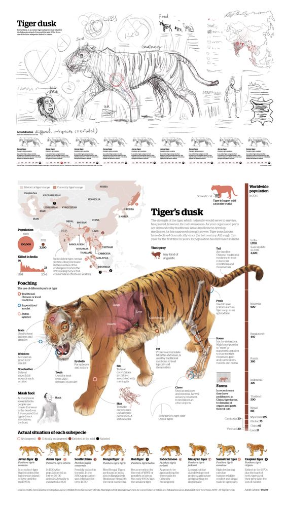

# CASE-10-老虎解剖、种群与保护信息｜老虎解剖、种群与保护信息

[原图](#01-示例图) · [文字分析](#02-案例分析报告) · [基础数据与附件](#03-基础数据与附件) · [同类案例](../README.md)

**基础数据逻辑**　[编目型](../../../../01-%E4%BF%A1%E6%81%AF%E5%9B%BE%E5%BD%A2%E6%95%B0%E6%8D%AE%E9%80%BB%E8%BE%91/03-%E7%BC%96%E7%9B%AE%E5%9E%8B%E4%BF%A1%E6%81%AF%E5%9B%BE%E5%BD%A2%E6%A6%82%E5%BF%B5%E5%AE%9A%E4%B9%89.md)  
**主表现标签**　[12-解剖型-Anatomical](../../00-%E6%A0%87%E7%AD%BE%E8%AF%B4%E6%98%8E.md)

## 01 示例图

[查看原尺寸](1.11.jpg)

## 02 案例分析报告

- 原图：1.11.jpg（会话附件）
- 五大基础逻辑唯一主归属：**03 编目型**
- 主表现标签：**解剖型（主）**；辅助标签：图片式；地标型；混合型
- 作者/出处/日期/来源URL：待核验

### A｜数据逻辑
以老虎身体结构为主视觉，标注器官、骨骼和身体部位，并补充亚种、分布、种群与威胁信息。

数据结构：身体部位—解剖属性；亚种—分布区域；种群/威胁指标。
分类依据：主导关系为03 编目型；其他图形或次级关系不改变唯一主归属。

### B｜统计图形与计算
表现标签：解剖型（主）；图片式；地标型；混合型。当前可确认图形结构和字段关系；原始数值、统计口径、分母和来源未完整提供，不反推。复现时补充原始数据、指标定义、单位、时间范围和计算口径。

### C｜视觉编码
大型虎图定位身体部位；细线引出结构标签；右侧数字与图表表达种群；底部虎形图比较亚种；地图表达分布。
点用于节点/对象定位；线用于路径、引线或连接；面用于模块/区域；体仅在确有三维表达时编码空间；符号/插画识别对象与类别；色彩/文字建立类别、层级和重点。

### D｜信息架构
最小记录单位为一个事件、对象、类别、步骤或指标条目。字段建议：record_id、item_name、category、time_or_place、attribute、value、unit、visual_role、evidence_status、source。可识别条目见基础数据CSV；未知数值留空。

### E｜视觉叙事
先认识整体，再看身体局部，继而扩展到亚种差异、分布和保护现状。

### 图形特性
以老虎身体结构为主视觉，标注器官、骨骼和身体部位，并补充亚种、分布、种群与威胁信息。

### 制作方法
分别建立解剖、亚种、保护指标表；主图标注部位；不同主题用独立图表；数量注明年份和来源。

### 制作流程
资料收集→术语核验→亚种分类→分布整理→主体标注→统计图表→来源核对。

### 图表垃圾检查
删除无信息功能且干扰阅读的装饰；检查图例、单位、比例、标注和阅读顺序；避免插画面积造成数量误读。

### 数据局限
分析依据为上传图片。小字和数值不可辨识时不转录；作者、出处、日期、来源和归档许可待核验。CSV为可见条目结构化记录，不是完整原始数据集。原图二进制需补传至仓库。

## 03 基础数据与附件

| 资料 | 文件 |
| --- | --- |
| 基础数据 | [基础数据.csv](%E5%9F%BA%E7%A1%80%E6%95%B0%E6%8D%AE.csv) |

### 基础数据预览

显示 前 5 条，CSV 共 8 条记录。空白沿用原 CSV。

| record\_id | item\_name | category | time\_or\_place | attribute | value | unit | visual\_role | evidence\_status | source |
| --- | --- | --- | --- | --- | --- | --- | --- | --- | --- |
| 10-01 | 头部 |  |  |  |  |  | 图面可见条目 | visible\_label\_or\_structure | 1.11.jpg |
| 10-02 | 眼睛 |  |  |  |  |  | 图面可见条目 | visible\_label\_or\_structure | 1.11.jpg |
| 10-03 | 牙齿 |  |  |  |  |  | 图面可见条目 | visible\_label\_or\_structure | 1.11.jpg |
| 10-04 | 骨骼 |  |  |  |  |  | 图面可见条目 | visible\_label\_or\_structure | 1.11.jpg |
| 10-05 | 皮毛/条纹 |  |  |  |  |  | 图面可见条目 | visible\_label\_or\_structure | 1.11.jpg |
