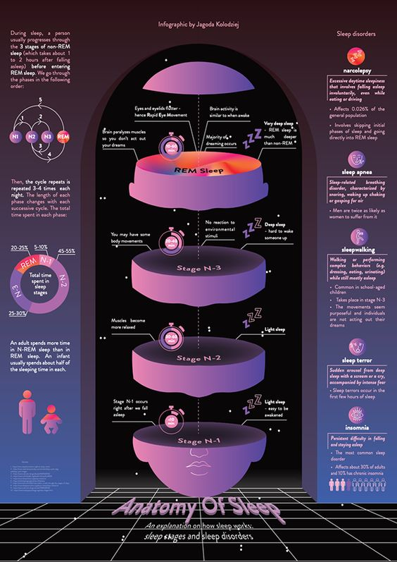

# CASE-27｜Anatomy of Sleep｜睡眠结构与睡眠障碍

[原图](#01-示例图) · [文字分析](#02-案例分析报告) · [基础数据与附件](#03-基础数据与附件) · [同类案例](../README.md)

**基础数据逻辑**　[层级型](../../../../01-%E4%BF%A1%E6%81%AF%E5%9B%BE%E5%BD%A2%E6%95%B0%E6%8D%AE%E9%80%BB%E8%BE%91/02-%E5%B1%82%E7%BA%A7%E5%9E%8B%E4%BF%A1%E6%81%AF%E5%9B%BE%E5%BD%A2%E6%A6%82%E5%BF%B5%E5%AE%9A%E4%B9%89.md)  
**主表现标签**　[12-解剖型-Anatomical](../../00-%E6%A0%87%E7%AD%BE%E8%AF%B4%E6%98%8E.md)

## 01 示例图

[查看原尺寸](2.27.jpg)

## 02 案例分析报告

### 元数据
- 案例 ID／作品名：CASE-27｜Anatomy of Sleep｜睡眠结构与睡眠障碍
- 原图文件名：2.27.jpg
- 作者／发布机构／发布日期：未从当前图片确认
- 原始来源 URL：未提供，待核验
- 原图归档许可：待核验；当前仅记录用户本次上传的研究材料
- 分析日期：2026-11-22
- 数据时间范围与单位：按图面可辨信息逐项记录；未读清处留空

### 五大基础类型主归属（唯一）
- 主归属：02 层级型
- 判断依据：中心以N1、N2、N3及REM等睡眠阶段作垂直堆叠和分层展示，并说明不同阶段的状态、周期关系与障碍类型；阶段结构和从属说明主导阅读。
- 排除其他类型的理由：主分类依据是全图主导的数据/信息关系，不因局部出现地图、时间、流程、层级或3D插画而改变。
- 主表现标签：12-解剖型-Anatomical
- 辅助表现标签：09-层级表现型-Hierarchical、01-混合型信息图形（Mixed Charts）

### A｜基本数据逻辑
最小单元为睡眠阶段/睡眠障碍条目；字段包括阶段名称、阶段特征、周期/时长描述、睡眠障碍类别与症状。

### B｜统计图形与计算
睡眠周期环形图、阶段堆叠结构、比例/时长图、睡眠障碍分类清单；具体百分比和时长需按图中文字核验。

### C｜视觉编码
黑色背景与紫粉渐变强化夜间主题；中央多层圆柱体把睡眠阶段空间化；垂直堆叠表达阶段层次；环形箭头/周期线表达重复循环；侧栏图标区分障碍类别。

### D｜数据／信息架构
- 建议数据粒度：一行代表一个独立条目/事件/地点/部件。
- 字段建议：record_id、entity、category、period_or_location、attribute、value、unit、visual_role、source_note。
- 具体图面可辨条目见同目录《基础数据.csv》。
- 当前数据表属于依据图面反向提取的基础条目，不代表已取得原始研究数据集。

### E｜视觉叙事架构
先介绍睡眠阶段的结构，再解释每一层的生理状态和周期变化，最后扩展到常见睡眠障碍及影响。

### 制作方法
把睡眠阶段作为主结构，先建立阶段层级与周期关系，再用侧栏解释每个阶段及障碍；3D圆柱是结构隐喻，不应误读为数值体积。

### 制作流程
1.核实睡眠阶段标准与资料来源；2.整理阶段及其特征；3.确认周期关系和时间口径；4.制作阶段堆叠示意与周期图；5.整理睡眠障碍分类；6.统一图标与侧栏；7.医学内容复核。

### 结论与知识回写
- 可复用规律：黑色背景与紫粉渐变强化夜间主题；中央多层圆柱体把睡眠阶段空间化；垂直堆叠表达阶段层次；环形箭头/周期线表达重复循环；侧栏图标区分障碍类别。
- 适用条件：主题具有可分类条目、可解释的对象关系，且图面需要兼顾总览与细节。
- 待核验问题：睡眠医学数据具有来源和人群差异，图面时长/百分比不可当作普适标准；中央圆柱体高度为概念结构表达，不能直接读作定量比例。
- 原图文件二进制：本次上传文件仍保留在当前对话；仓库暂存分析和CSV，原图二进制待通过支持二进制的仓库上传方式补入。

## 03 基础数据与附件

| 资料 | 文件 |
| --- | --- |
| 基础数据 | [基础数据.csv](%E5%9F%BA%E7%A1%80%E6%95%B0%E6%8D%AE.csv) |

### 基础数据预览

显示 5 条记录。空白沿用原 CSV。

| record\_id | entity | category | period\_or\_location | attribute | value | unit | visual\_role | source\_note |
| --- | --- | --- | --- | --- | --- | --- | --- | --- |
| 27-1 | N1 | 睡眠阶段 | 非REM | 阶段特征说明 |  |  | 中央分层 |  |
| 27-2 | N2 | 睡眠阶段 | 非REM | 阶段特征说明 |  |  | 中央分层 |  |
| 27-3 | N3 | 睡眠阶段 | 非REM | 深睡眠阶段说明 |  |  | 中央分层 |  |
| 27-4 | REM | 睡眠阶段 | REM | 快速眼动睡眠说明 |  |  | 中央分层 |  |
| 27-5 | Sleep disorders | 障碍类别 | 睡眠健康 | 图示多种睡眠障碍 |  |  | 右侧分类 |  |
